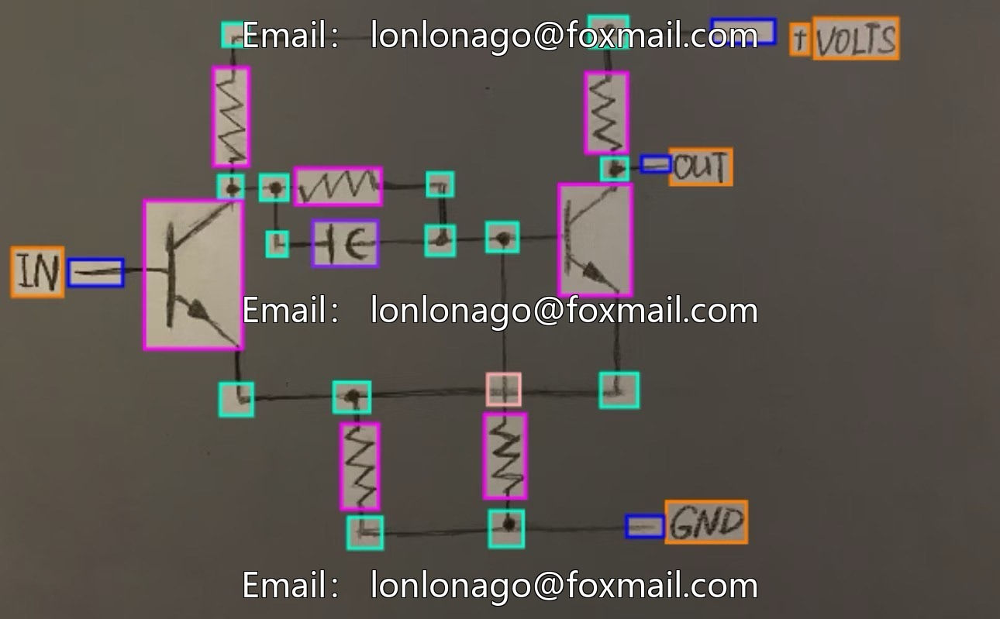
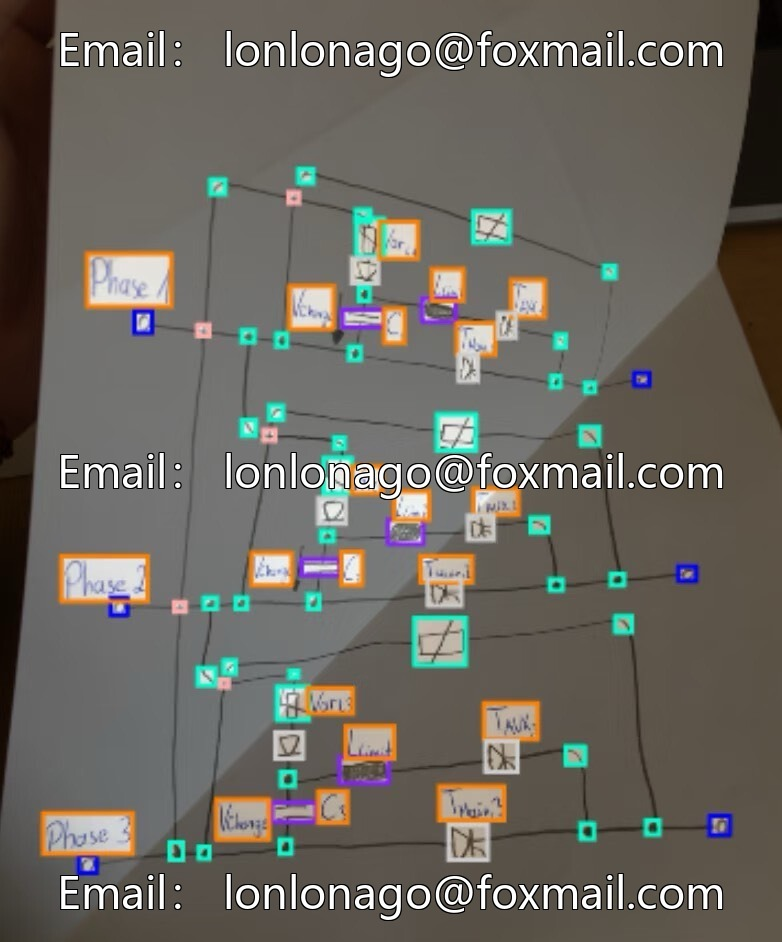
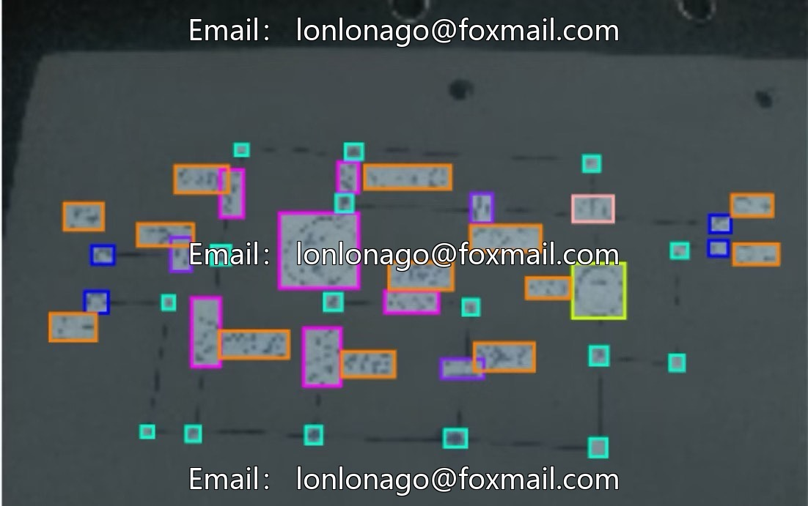
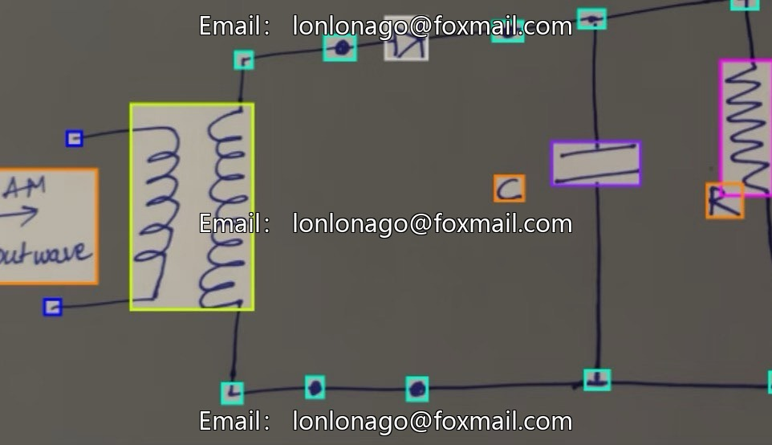
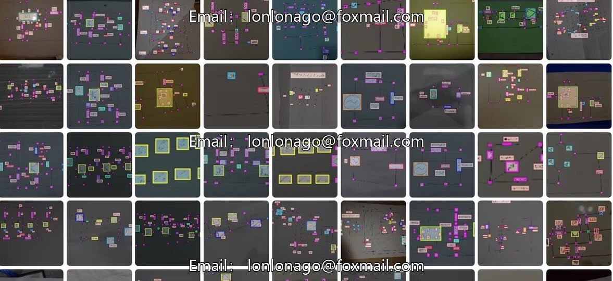

# Intelligent Industry Electronic Component Identification Dataset, Issue 10616, Including Circuit Diagram Recognition

## Body

Intelligent Industrial Electronics Recognition Data Set, Issue 10616. This dataset includes scenarios such as circuit diagram recognition, simulation of circuit operation principles, automated electronic device inspection, component sorting, and circuit fault diagnosis. It is suitable for intelligent upgrade tasks in industrial vision inspection, automation disassembly, and intelligent maintenance.

The dataset consists of 45 categories of electronic components, such as resistors, diodes, inductors, transistors, transformers, motors, switches, sockets, speakers, antennas, and text labels, totaling 1100 images with complete annotations. It supports YOL0 format and can be directly used without format conversion.

Data format: image file + txt annotations, including category ID and target box coordinates. It is compatible with YOLOv8, YOLOv11, etc. Object detection models. It can also be used for component positioning and recognition, and can be combined with OCR to extend text identification extraction.

Virtual materials, once sold, are non-refundable.
Interested friends, click "I want" to proceed.

## Images

## Payment

Here is a pay link on Stripe ( https://buy.stripe.com/3cs8yP7sY87d0vu9AB ). Please contact me lonlonago@foxmail.com after funding $89, and I will send you a complete data files , thank you!

